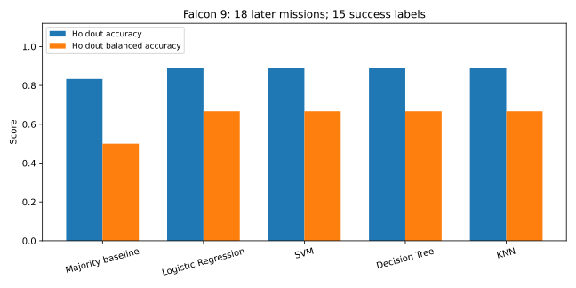

# Falcon 9 Landing Prediction

**An IBM Applied Data Science capstone by Mayank Raj**

Analyze historical Falcon 9 missions, explore the factors associated with first-stage landing outcomes, and compare four classification models. This repository includes the notebooks, datasets, interactive dashboard, maps, and original presentation.

**Python · pandas · SQL · BeautifulSoup · Folium · Plotly Dash · scikit-learn**

[My portfolio](https://mayank-raj-the-series.adoredteal16.chatgpt.site) · [Launch-site map](spacex_map.html) · [Original presentation](<ds-capstone-template-coursera (1).pptx>)


## The question

Which patterns in historical launch information are associated with successful first-stage landings? Booster recovery provides useful context for launch economics, but this analysis does not calculate launch costs or support operational launch decisions.

## What the project demonstrates

- Collecting SpaceX launch records through REST APIs and a Wikipedia scraping notebook.
- Cleaning data and creating binary landing labels and modelling features.
- Exploring payload, orbit, launch-site and time patterns with SQL and charts.
- Mapping launch sites and landing outcomes with Folium.
- Filtering launch records in a Dash application.
- Comparing Logistic Regression, SVM, Decision Tree and KNN with GridSearchCV.

## Reported results and interpretation

### Updated chronological validation

The original course scores below are retained as historical results. For the new
analysis, run `python model_validation.py` after installing
`requirements-model-lock.txt`. It trains on earlier missions and holds out later
missions, fits preprocessing within training folds, compares a majority baseline,
and reports precision, recall, F1 and balanced accuracy. The saved, globally
imputed payload column is excluded. Model choice uses training cross-validation.

See [the new report](reports/validation/REPORT.md),
[all metrics and fold details](reports/validation/metrics.json), and
[every held-out prediction](reports/validation/holdout_predictions.csv).



The capstone uses approximately **90 missions from 2010–2020**, with an 80/20 train/test split. Its original notebook and presentation report:

| Model | Reported test accuracy |
| :--- | ---: |
| Logistic Regression | 83.3% |
| Support Vector Machine | 83.3% |
| Decision Tree | 83.3% |
| K-Nearest Neighbors | 83.3% |

The reported confusion matrix has 12 true positives, 3 true negatives, 3 false positives and no false negatives. These are historical results from the supplied course workflow, rather than a newly reproduced benchmark.

**Validation limits:** the test set contains only 18 missions. The original notebook fits its scaler before the train/test split, creating a leakage risk. A stronger follow-up should fit preprocessing inside a cross-validation pipeline, compare a baseline, report precision/recall, and assess later launches with a chronological holdout. The four tied test scores do not establish one model as consistently best.

## Run the dashboard locally

Use Python 3.12. From this repository:

```powershell
python -m venv .venv
.\.venv\Scripts\python.exe -m pip install -r requirements-lock.txt
.\.venv\Scripts\python.exe spacex_dash_app.py
```

Open the local address printed by Dash, normally `http://127.0.0.1:8050`. Choose a launch site and payload range. The CSV is resolved relative to the application file, so launching from another folder also works.

The dashboard uses `spacex_launch_dash.csv`; its subset differs from the 90-record modelling dataset. Its charts show the supplied observations, not a live SpaceX feed. The all-site pie shows successful landing counts by site, rather than each site's success rate.

## Follow the analysis

| Step | File |
| :--- | :--- |
| API collection | [Data collection notebook](jupyter-labs-spacex-data-collection-api.ipynb) |
| Web scraping | [Wikipedia scraping notebook](jupyter-labs-webscraping.ipynb) |
| Wrangling | [Preparation notebook](<labs-jupyter-spacex-Data wrangling.ipynb>) |
| Visual exploration | [EDA notebook](edadataviz.ipynb) |
| SQL | [SQLite notebook](jupyter-labs-eda-sql-coursera_sqllite.ipynb) |
| Geography | [Launch-site notebook](lab_jupyter_launch_site_location.ipynb) |
| Modelling | [Prediction notebook](<SpaceX_Machine Learning Prediction_Part_5.ipynb>) |
| Dashboard | [Dash application](spacex_dash_app.py) |

Some notebooks retain IBM Skills Network / JupyterLite helpers such as `piplite` and browser `js.fetch`. They are preserved as course artifacts and may need adaptation for a normal local Jupyter kernel. Network collection cells depend on the original external endpoints. The dashboard installation above is independently runnable; it does not promise all notebooks will run unchanged offline.


## Data and attribution

Local CSVs include `dataset_part_1.csv`, `dataset_part_2.csv`, `dataset_part_3.csv`, `spacex_web_scraped.csv`, and `spacex_launch_dash.csv`. Collection methods and upstream course URLs are retained in the notebooks. This is educational work completed as part of the IBM Applied Data Science capstone; source data and course materials retain their respective ownership.

## Check the dashboard changes

```powershell
.\.venv\Scripts\python.exe -m pip install -r requirements-model-lock.txt
.\.venv\Scripts\python.exe -m unittest discover -s tests -v
.\.venv\Scripts\python.exe model_validation.py
```

The checks exercise dashboard filters and the HTTP response, strict separation of
training and later holdout dates, training-only scaler fitting, and baseline
metrics. The model script reruns the new chronological analysis; it does not
reproduce the original random-split course benchmark.

## Author

Mayank Raj · [LinkedIn](https://www.linkedin.com/in/mayankraj-data-science/) · [Portfolio](https://mayank-raj-the-series.adoredteal16.chatgpt.site)
